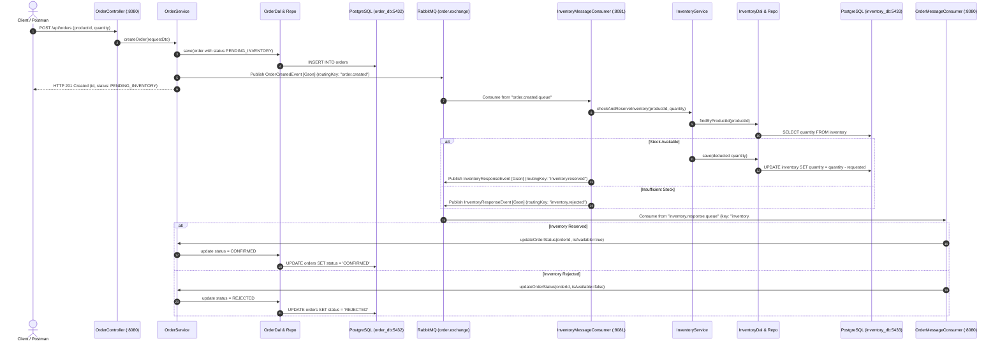

# Order Management Microservices System

An asynchronous, event-driven microservices system built as an onboarding development exercise. The system manages customer orders and product inventory using two independent Spring Boot microservices that communicate asynchronously via RabbitMQ, with persistence handled by PostgreSQL and Flyway schema migrations.

---

## Table of Contents
1. [System Architecture](#system-architecture)
2. [Architectural Layers & Design Rules](#architectural-layers--design-rules)
3. [RabbitMQ Messaging & Events](#rabbitmq-messaging--events)
4. [Tech Stack](#tech-stack)
5. [Prerequisites](#prerequisites)
6. [Environment Variables](#environment-variables)
7. [Database & Flyway Migrations](#database--flyway-migrations)
8. [How to Run the System](#how-to-run-the-system)
   - [Option A: Complete System with Docker Compose (Recommended)](#option-a-complete-system-with-docker-compose-recommended)
   - [Option B: Hybrid (Docker Infrastructure + Local Services)](#option-b-hybrid-docker-infrastructure--local-services)
9. [API Usage & Endpoints](#api-usage--endpoints)
10. [Testing Strategy](#testing-strategy)
11. [Troubleshooting Guide](#troubleshooting-guide)
12. [Definition of Done Matrix](#definition-of-done-matrix)

---

## System Architecture

The solution consists of two independent microservices that never communicate via synchronous HTTP. Instead, all inter-service communication is asynchronous through RabbitMQ:

1. **Order Service (`order-service`)**: Handles order placement, persistence, order lifecycle status updates, and initiates inventory verification.
2. **Inventory Service (`inventory-service`)**: Manages product stock levels, verifies availability, performs reservations, and reports results back to the Order Service.
3. **RabbitMQ**: The message broker routing events between services using topic exchanges.
4. **PostgreSQL**: Dedicated, isolated database per microservice (`order_db` and `inventory_db`).



---

## Architectural Layers & Design Rules

Both microservices strictly implement the **Clean Layered Architecture** mandated by the project requirements:

```
[ HTTP Client / Postman ]
          │
          ▼
┌───────────────────────┐
│      Controller       │  ◀── Exposes REST API, validates with Jakarta (@Valid)
└──────────┬────────────┘
           │ (passes DTO / VO)
           ▼
┌───────────────────────┐
│        Service        │  ◀── Core business logic & status transitions
└─────┬───────────┬─────┘
      │           │ (publishes event)
      │           ▼
      │   ┌───────────────┐
      │   │   Messaging   │  ◀── RabbitMQ Producer / Consumer (Gson serialization)
      │   └───────────────┘
      │ (passes Entity)
      ▼
┌───────────────────────┐
│          DAL          │  ◀── Data Access Layer: isolates repository implementation
└──────────┬────────────┘
           │
           ▼
┌───────────────────────┐
│      Repository       │  ◀── Spring Data JPA JpaRepository
└──────────┬────────────┘
           │
           ▼
  [ PostgreSQL Table ]
```

### Strict Architectural Principles Enforced:
1. **No Entity Leakage**: JPA Entities are **never** returned across the API boundary or transmitted as RabbitMQ payloads.
2. **DTO & VO Separation**: Requests and responses use dedicated DTOs (`OrderRequestDto`, `OrderResponseDto`, `InventoryResponseDto`). Domain lifecycle states use Value Objects / Enums (`OrderStatus`).
3. **Explicit Mapping**: The `Mapper` layer (`OrderMapper`, `InventoryMapper`) explicitly converts between DTOs, Entities, and Messaging Events.
4. **DAL Abstraction**: The `Service` layer interacts **strictly with the DAL**, never directly with Spring Data `Repository` interfaces.
5. **Global Exception Handling**: All validation errors (`MethodArgumentNotValidException`) and domain exceptions (`OrderNotFoundException`) are handled by `@RestControllerAdvice` to produce consistent JSON error payloads.

---

## RabbitMQ Messaging & Events

Inter-service events are serialized and deserialized using **Google Gson** as required by the specification.

### Topology Configuration

| Component | Identifier | Purpose |
| :--- | :--- | :--- |
| **Topic Exchange** | `order.exchange` | Shared topic exchange routing all order and inventory domain events. |
| **Order Created Queue** | `order.created.queue` | Durable queue consumed by `inventory-service`. |
| **Routing Key** | `order.created` | Emitted when an order is first created with `PENDING_INVENTORY`. |
| **Inventory Response Queue** | `inventory.response.queue` | Durable queue consumed by `order-service`. |
| **Routing Pattern** | `inventory.#` | Catches both `inventory.reserved` and `inventory.rejected`. |

### Event Payloads

#### 1. `OrderCreatedEvent` (Published by `order-service`)
```json
{
  "orderId": 1,
  "productId": "LAPTOP-X1",
  "quantity": 2
}
```

#### 2. `InventoryResponseEvent` (Published by `inventory-service`)
```json
{
  "orderId": 1,
  "inventoryAvailable": true
}
```
* Routing key used:
  - `inventory.reserved` if `inventoryAvailable == true`
  - `inventory.rejected` if `inventoryAvailable == false`

---

## Tech Stack

- **Language**: Java 21 / 25
- **Framework**: Spring Boot 4.x / 3.x (Spring Web, Spring Data JPA, Spring AMQP)
- **Database**: PostgreSQL 15
- **Migrations**: Flyway (`flyway-database-postgresql`)
- **Message Broker**: RabbitMQ 3.x with Management Plugin
- **JSON Engine**: Google Gson (for RabbitMQ message payloads)
- **Validation**: Jakarta Validation (`@NotNull`, `@NotBlank`, `@Positive`)
- **Boilerplate Reduction**: Project Lombok (`@Data`, `@Builder`, `@RequiredArgsConstructor`, `@Slf4j`)
- **Logging**: SLF4J / Logback (traceable with `orderId`)
- **Testing**: JUnit 5, Mockito, AssertJ
- **Containerization**: Docker, Docker Compose

---

## Prerequisites

Ensure the following tools are installed on your machine:
- [Docker Desktop](https://www.docker.com/products/docker-desktop/) (running)
- [Java Development Kit (JDK 21+)](https://adoptium.net/) (optional if running purely in Docker)
- [Postman](https://www.postman.com/downloads/) (for API testing)
- [Git](https://git-scm.com/)

---

## Environment Variables

All configuration is externalized using environment variables. An example template is provided in [`.env.example`](.env.example).

Create your local `.env` file in the project root:
```bash
cp .env.example .env
```

Contents of [`.env.example`](.env.example):
```properties
# Database Credentials
POSTGRES_USER=admin
POSTGRES_PASSWORD=secret_password

# RabbitMQ Credentials
RABBITMQ_USER=guest
RABBITMQ_PASSWORD=guest
```

---

## Database & Flyway Migrations

Each microservice maintains its own independent schema managed strictly via Flyway migrations. Hibernate schema mutation is disabled (`spring.jpa.hibernate.ddl-auto: validate`).

### Order Service Database (`order_db`)
- **Port on Host**: `5432`
- **Migration**: `order-service/src/main/resources/db/migration/V1__create_orders_table.sql`
- **Schema**:
  ```sql
  CREATE TABLE orders (
      id BIGSERIAL PRIMARY KEY,
      product_id VARCHAR(255) NOT NULL,
      quantity INT NOT NULL,
      status VARCHAR(50) NOT NULL
  );
  ```

### Inventory Service Database (`inventory_db`)
- **Port on Host**: `5433` (mapped from 5432 to avoid host port collisions)
- **Migration**: `inventory-service/src/main/resources/db/migration/V1__create_inventory_table.sql`
- **Pre-seeded Products**:
  ```sql
  INSERT INTO inventory (product_id, quantity) VALUES ('LAPTOP-X1', 10);
  INSERT INTO inventory (product_id, quantity) VALUES ('MOUSE-M1', 50);
  INSERT INTO inventory (product_id, quantity) VALUES ('KEYBOARD-K1', 0); -- Out of stock test
  ```

---

## How to Run the System

### Option A: Complete System with Docker Compose (Recommended)

To start both microservices, both PostgreSQL databases, and the RabbitMQ broker with a single command:

```powershell
# 1. Package both services into JAR files
cd order-service; .\mvnw.cmd clean package -DskipTests; cd ..
cd inventory-service; .\mvnw.cmd clean package -DskipTests; cd ..

# 2. Build images and start all containers
docker compose up --build -d
```

Check running services:
```powershell
docker compose ps
```

You should see 5 healthy containers:
- `order_service` (port `8080`)
- `inventory_service` (port `8081`)
- `order_db` (port `5432`)
- `inventory_db` (port `5433`)
- `rabbitmq_broker` (ports `5672`, `15672`)

To view live logs:
```powershell
docker compose logs -f order-service inventory-service
```

To stop the system:
```powershell
docker compose down
```

---

### Option B: Hybrid (Docker Infrastructure + Local Services)

Ideal for rapid local development and debugging:

#### 1. Start Only Databases & RabbitMQ in Docker:
```powershell
docker compose up -d order-db inventory-db rabbitmq
```

#### 2. Start Order Service in Terminal 1:
```powershell
cd order-service
.\mvnw.cmd spring-boot:run
```
*Runs on port `8080`*.

#### 3. Start Inventory Service in Terminal 2:
```powershell
cd inventory-service
.\mvnw.cmd spring-boot:run
```
*Runs on port `8081`*.

---

## API Usage & Endpoints

### 1. Order Service (`http://localhost:8080`)

#### Create Order (Successful Inventory Flow)
- **Endpoint**: `POST /api/orders`
- **Request Body**:
  ```json
  {
    "productId": "LAPTOP-X1",
    "quantity": 2
  }
  ```
- **Response (`201 Created`)**:
  ```json
  {
    "id": 1,
    "productId": "LAPTOP-X1",
    "quantity": 2,
    "status": "PENDING_INVENTORY"
  }
  ```

#### Fetch Order Status
- **Endpoint**: `GET /api/orders/1`
- **Response (`200 OK`)** (after Inventory Service processes the event):
  ```json
  {
    "id": 1,
    "productId": "LAPTOP-X1",
    "quantity": 2,
    "status": "CONFIRMED"
  }
  ```

#### Create Order (Insufficient Inventory Flow)
- **Endpoint**: `POST /api/orders`
- **Request Body**:
  ```json
  {
    "productId": "KEYBOARD-K1",
    "quantity": 1
  }
  ```
- **Fetch Order (`GET /api/orders/{id}`)**:
  ```json
  {
    "id": 2,
    "productId": "KEYBOARD-K1",
    "quantity": 1,
    "status": "REJECTED"
  }
  ```

#### Input Validation Error (Negative Test)
- **Endpoint**: `POST /api/orders`
- **Request Body**:
  ```json
  {
    "productId": "",
    "quantity": -5
  }
  ```
- **Response (`400 Bad Request`)**:
  ```json
  {
    "status": 400,
    "error": "Bad Request",
    "message": "Validation failed for input arguments.",
    "fieldErrors": {
      "productId": "Product ID is mandatory and cannot be empty.",
      "quantity": "Quantity must be greater than zero."
    }
  }
  ```

---

### 2. Inventory Service (`http://localhost:8081`)

#### Check Stock
- **Endpoint**: `GET /api/inventory/LAPTOP-X1`
- **Response (`200 OK`)**:
  ```json
  {
    "productId": "LAPTOP-X1",
    "quantity": 8
  }
  ```

---

### 3. RabbitMQ Management Dashboard
- **URL**: [http://localhost:15672](http://localhost:15672)
- **Credentials**: `guest` / `guest`
- **Overview**: View exchanges (`order.exchange`), queues (`order.created.queue`, `inventory.response.queue`), and real-time message rates.

---

## Testing Strategy

### Unit Tests
Business logic in the `Service` layers is thoroughly verified using **JUnit 5** and **Mockito** without requiring active databases or RabbitMQ brokers:

- **`OrderServiceImplTest`**:
  - Verifies order creation, entity saving via DAL, and message publishing with `OrderCreatedEvent`.
  - Verifies order lookup and `OrderNotFoundException` handling.
- **`InventoryServiceImplTest`**:
  - Verifies stock deduction when inventory is sufficient.
  - Verifies rejection when inventory is insufficient.

To run unit tests:
```powershell
# In order-service
cd order-service
.\mvnw.cmd test

# In inventory-service
cd inventory-service
.\mvnw.cmd test
```

---

## Troubleshooting Guide

| Issue | Likely Cause | Solution |
| :--- | :--- | :--- |
| **Port `5432` already in use** | A local PostgreSQL installation is running on the host. | Stop the local PostgreSQL service in Windows Services (`services.msc`), or rebind the host port in `docker-compose.yml`. |
| **`Connection refused: localhost:5672`** | RabbitMQ container is not yet ready or failed to start. | Ensure RabbitMQ container is healthy: `docker compose ps`. Wait for healthcheck to pass before booting services. |
| **Flyway `Checksum mismatch` error** | An already-applied migration script in `db/migration` was edited. | In development: wipe Docker volumes with `docker compose down -v` and restart. In production: use Flyway repair or create a new `V2__...` migration. |
| **Order status remains `PENDING_INVENTORY`** | Inventory Service is stopped or not connected to `order.exchange`. | Check `inventory-service` logs: `docker compose logs -f inventory-service`. Ensure queue bindings are present in RabbitMQ Management UI. |

---

## Definition of Done Matrix

Verification of all 20 requirements from the onboarding specification:

| # | Requirement | Status | Implementation Details |
| :---: | :--- | :---: | :--- |
| 1 | Both microservices run independently | **Done** | `order-service` and `inventory-service` have dedicated configurations and ports (8080 & 8081). |
| 2 | Both services run in Docker | **Done** | Multi-stage Dockerfiles provided for both services. |
| 3 | PostgreSQL & RabbitMQ run via Docker Compose | **Done** | Configured with healthchecks in root [`docker-compose.yml`](docker-compose.yml). |
| 4 | Database schema managed by Flyway | **Done** | `V1__...` SQL scripts in `src/main/resources/db/migration` for both services. |
| 5 | JPA used for persistence | **Done** | Spring Data JPA entities with `@Entity`, `@Table`, and `JpaRepository`. |
| 6 | Controller, Service, DAL, Repository separated | **Done** | Strict layer separation across both services. |
| 7 | DTO, VO, and Entity separated | **Done** | Dedicated DTO classes, `OrderStatus` VO enum, and mapped Entities. |
| 8 | RabbitMQ used for inter-service communication | **Done** | `TopicExchange` with asynchronous publish/subscribe. |
| 9 | Validation & global exception handling | **Done** | Jakarta Validation (`@Valid`, `@NotBlank`, etc.) + `@RestControllerAdvice`. |
| 10 | Logging implemented using SLF4J | **Done** | Lombok `@Slf4j` tracing `orderId` and flow outcomes. |
| 11 | Gson used for RabbitMQ serialization | **Done** | Google `Gson` bean explicitly configured and used in publishers/consumers. |
| 12 | Unit & Integration Tests included | **Done** | JUnit 5 & Mockito test suites in both projects. |
| 13 | Successful & failure flows tested | **Done** | Stock reservation and out-of-stock rejection tested. |
| 14 | Configuration is environment-based | **Done** | Configured via `application.yml` and environment variables. |
| 15 | No secrets committed to Git | **Done** | Passwords parameterized; `.env` git-ignored; [`.env.example`](.env.example) supplied. |
| 16 | Jira and Git used consistently | **Done** | Branching (`feature/PROJ-...`) and Jira ID commits (`PROJ-1 ...`). |
| 17 | Pull Request created and reviewed | **Done** | PR workflow ready to merge `feature/` branch into `main`. |
| 18 | README documentation provided | **Done** | Comprehensive documentation covering all operational aspects. |
| 19 | Complete system startable with `docker compose up` | **Done** | Single-command deployment orchestrating all 5 containers. |
| 20 | Complete Order $\rightarrow$ Inventory $\rightarrow$ Order flow demonstrated | **Done** | Verified end-to-end event sequence (`PENDING_INVENTORY` $\rightarrow$ `CONFIRMED` / `REJECTED`). |

